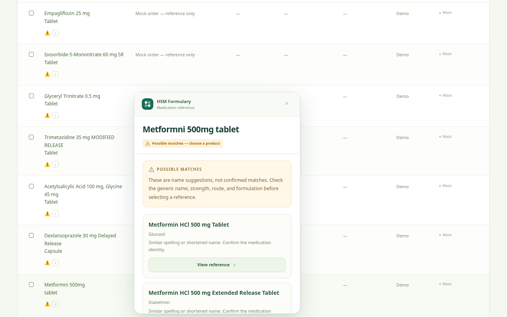
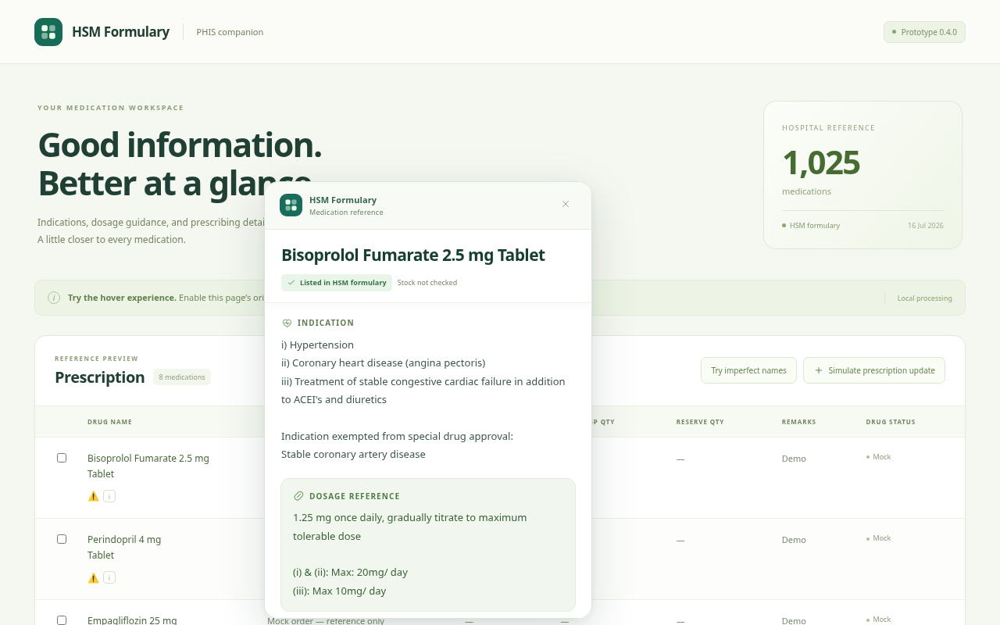
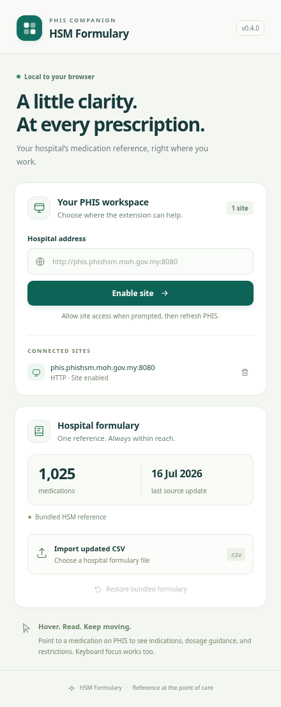

# HSM PHIS Formulary extension

Edge/Chrome Manifest V3 prototype. Bundles 1,025 entries from the supplied HSM CSV, recorded update date 16/07/2026. All reference processing and CSV imports stay in the browser. No analytics or remote clinical requests.

## Version 0.4.0

### Possible matches

When no exact generic or brand label matches, a local, conservative name comparison can suggest close spellings, shortened names, and names missing salt words. For example, `Metformni 500mg tablet` offers the matching metformin records, and `Bisoprolol 2.5 mg Tab` offers the 2.5 mg tablet reference.

- Suggestions appear in an amber **Possible matches** list. Indications and dosage guidance remain hidden until you choose **View reference** for a product.
- Each choice shows the full formulary name and brand, with warnings when strength, form, release type, or route is missing. Explicitly conflicting strengths, concentrations, forms, release types, routes, and salts are excluded from suggestions. Different active ingredient words are not silently dropped.
- Choosing a reference keeps an amber **Selected reference — verify product** badge and the original PHIS label visible. Use **Back to possible matches** to choose another record, or **None of these — close** to dismiss the list.
- This selection is temporary. It does not change PHIS, save an alias, or automatically apply to another row or later hover.
- The list shows at most five candidates and notes when more exist. Very short, unrelated, or unsupported abbreviations may still have no suggestions. Suggestions are not clinically validated equivalence decisions.
- Ambiguous exact brand names (such as Dexilant with two strengths) and the known Glyceryl Trinitrate route omission also require choosing a record before clinical details appear.

### Interface

The medication name, match status, and close button stay visible while you scroll the reference. Opening a different medication starts at the top of its information.

A refreshed interface for the extension and demo: soft green and teal colours, a matching toolbar icon, clearer typography, and responsive settings cards. The medication popup separates indications, dosage guidance, and restrictions, with administrative information under **Prescribing details**. Product/route confirmation remains prominent for uncertain matches. Fonts and icons are bundled or supplied by the system; the interface does not load remote assets.

Settings now show the active source, formatted update date, medication count, connected sites, and clear import/permission status. Addresses without a scheme use HTTP. Removing one port preserves access for other registered origins on the same host.

### Interface previews

These screenshots use synthetic demo orders and simulated extension API bindings. They show the actual extension HTML/CSS.

[Preview the popup scrolled to the bottom, with its medication title still visible](docs/previews/medication-popup-scrolled.png)

## Medication detection (introduced in 0.2.0)

The demo now uses the seven medication labels visible in the supplied PHIS screenshot, with synthetic orders and icons. No patient or prescriber details from the screenshot are included. Wrapped labels and non-medication icons are handled separately. When table headers are available, detection is restricted to the Drug Name column. Recognised cells become keyboard-focusable, including dynamically replaced rows. Popups prefer the side of the medication column and dismiss stale references when rows change.

- `Trimetazidine 35 mg MODIFIED RELEASE Tablet` matches the formulary's `Trimetazidine 35mg MR Tablet`. Standard full phrases for modified, sustained, and extended release map to MR, SR, and ER respectively; these release types remain distinct.
- `Glyceryl Trinitrate 0.5 mg Tablet` appears only as a **possible reference**, because the formulary specifies **Sublingual Tablet**. The popup asks the user to confirm route and product. It does not identify that PHIS label as a confirmed formulary match.
- Strengths, decimal points, and concentration slashes are preserved in matching. Unknown suffixes and additional combination ingredients are not ignored.

## Install in Edge

1. Extract the downloadable ZIP.
2. Open `edge://extensions`, enable Developer mode, choose **Load unpacked**, and select the `extension` folder.
3. Open the extension toolbar popup. Enter your full PHIS site address, for example `http://phis.phishsm.moh.gov.my:8080` or `http://10.138.118.11:8080`, and choose **Enable site**. Approve the browser's site permission.
4. Reload PHIS and hover a medication name. Recognised medication cells support keyboard focus as well. Escape closes it.

Chrome uses `chrome://extensions` with the same steps. Addresses are configurable; nothing automatically grants access to the hospital examples. Browser host permissions cover the hostname; the content script additionally checks the exact registered origin, including port. Removing an origin preserves shared hostname permissions while another registered origin still needs them.

## Demo and checks

Run `python -m http.server 8080 --directory demo` from this repository. Register `http://localhost:8080` in the extension and reload the demo. Hover Dexlansoprazole; use **Simulate prescription update** to test a newly added row. Choose **Try imperfect names** to append example misspelled and shortened labels; hover them to try candidate selection.

Run `node --test tests/formulary.test.cjs` for the twenty data, matching, and CSV tests, including typo/prefix suggestions, omitted-detail warnings, incompatible strengths/concentrations/forms/releases/routes/salts, ingredient boundaries, and bounded results. Optional browser regression: with Playwright 1.62.1 and Chromium installed, run `node tests/browser.cjs`; it starts and stops its own local demo server. Set `CHROMIUM_PATH` if Chromium is not at `/usr/bin/chromium`. That browser test mocks extension APIs and verifies all seven screenshot labels plus a reference example, route confirmation, icon filtering, hover persistence, popup bounds, Escape, column scoping, dynamic keyboard focus, stale reference dismissal, and exact-origin restrictions. It also verifies expandable prescribing details, sticky titles during scrolling, candidate selection using keyboard and mouse, clinical details hidden before selection, switching/back/dismissal, nonpersistent choices, and ambiguous brands. It does not verify installed extension permissions.

Run `node tests/settings-browser.cjs` with the same browser prerequisites to check the settings at popup, small-screen, and full-page sizes, permission denial/registration, shared-host removal, CSV import/rejection/restore, and source metadata. This suite also uses simulated extension APIs. Both browser suites start and stop their own local servers. Optional: set `PHIS_SCREENSHOT_DIR` to save screenshots during these runs.

Actual unpacked-extension loading could not be tested on the cloud machine: its Chromium policy disables loading unpacked extensions. Test the install/enable/reload flow in your authorised Edge environment.

## CSV updates

Use the popup to import a CSV. The parser locates the `Generic Name` header after any metadata, supports quoted multiline fields, and requires `Indication` and `Dosage` columns. Invalid files are rejected before replacing the active reference. Reload PHIS after import or restore. The original CSV is not modified.

## Current boundaries

Detection uses generic table cells and ZK label/list-cell classes. Real PHIS DOM integration is pending a sanitised outerHTML sample. Normalised full generic names, standard release abbreviations, and full brand labels are supported. Exact matching has priority. Nonexact suggestions and ambiguous brands require an explicit product choice before clinical details are shown. Some abbreviations, misspellings, or incomplete ingredient names remain unsupported. Strength and release type are not discarded. Unknown medications receive no popup; absence of a popup is not proof that a medication is absent from the formulary. Buttons, images, hidden content, and recognised icon elements are excluded from name extraction. Other PHIS-specific markup may still need adjustment after DOM inspection. A screenshot alone cannot identify the exact selectors, frames, or event behavior used by the live system.

Formulary listing does not indicate stock. Dosage is source reference text, not a patient-specific recommendation. No drug interaction checking is implemented. The dataset and clinical presentation require pharmacist review before clinical use. The extension does not alter prescriptions.

## Updating an unpacked installation

Download the latest GitHub ZIP and extract it to a stable folder. Replace the files in the extension folder you previously loaded, then open `edge://extensions` and choose **Reload** on HSM PHIS Formulary. Check that version **0.4.0** is shown, then reload your PHIS tab. Keeping the same loaded folder preserves the extension identity and local settings. If you instead load a different folder as a new extension, disable/remove the previous copy and register your PHIS address again.
