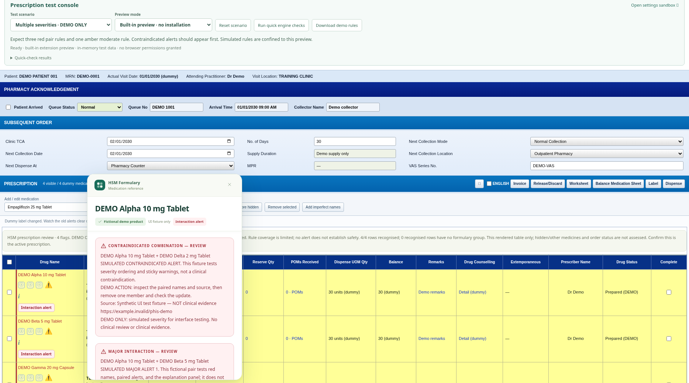

# HSM PHIS Formulary extension

Edge/Chrome Manifest V3 prototype. Bundles 1,025 entries from the supplied HSM CSV, recorded update date 16/07/2026. All reference processing and CSV imports stay in the browser. No analytics or remote clinical requests.

## Version 0.6.0 — PHIS dummy and test console

Download the [latest ZIP](https://github.com/vasfplhsm/PHIS-HSM-Formulary-Integration/archive/refs/heads/main.zip), extract it, and open **OPEN-DEMO.html** in Edge. The built-in preview needs no extension installation. The page approximates the supplied PHIS screenshot: blue section bars, collection fields, icons, and a yellow prescription grid, with fictional patient and order details.

Choose **Major interaction 1 · DEMO ONLY** to see red medication names, then click **Interaction alert**. Twelve presets cover two major pairs, a contraindicated pair, multiple severities, moderate alerts, shared formulary groups, imperfect names, ambiguous brands, unknown medicines, missing rules, and separate prescriptions. Add, edit, hide, restore, or remove rows to check live updates. The scrollable reference keeps the medication title visible. A settings sandbox lets you try CSV import without changing your installed extension.

**The interaction examples use fictional DEMO products and synthetic rules, with no clinical claims or approval.** They are confined to the local preview. The normal clinical rules importer rejects them. Real medicine references still come from the supplied HSM formulary; no approved interaction database is bundled.

See the [demo launch guide and scenario checklist](docs/demo-guide.md), including the local-server fallback if your browser blocks opening HTML files.

## Prescription review and reference features

### Prescription review and interaction-rule import

- Amber medication text and a **Group / ingredient review** badge identify shared nonempty CSV sub-pharmacology groups. These broad categories are review flags; they do not establish therapeutic duplication or an interaction. Broad pharmacology alone is never used. This option can be disabled in settings.
- A local ruleset import supports reviewed product-to-ingredient/class mappings and source-cited interaction pairs. Clinical details show the pair, severity, effect, action, source, ruleset version, and declared reviewer. A major/contraindicated rule produces red highlighting and a sticky alert badge; moderate/minor rules stay amber.
- **No approved clinical interaction dataset is bundled. Drug interactions are not checked until reviewed rules are imported.** The settings page offers a blank draft template and displays the loaded ruleset's review metadata. Metadata is a declaration by the file's supplier, not independently verified approval.
- Checks stay within one rendered prescription table exposing Drug Name and Order Detail headers. Ambiguous/fuzzy matches and hidden rows are excluded. Coverage is shown explicitly; other medicines, clinical context, and order status are not assessed. Confirm that the displayed table is the active prescription. No alert does not establish safety.
- Row changes clear obsolete flags and refresh coverage. Prescription fields are not edited, and medication lists are not stored or sent to a remote service.

See [reviewed rules format and import instructions](docs/rules-format.md).

### Possible matches

When no exact generic or brand label matches, a local, conservative name comparison can suggest close spellings, shortened names, and names missing salt words. For example, `Metformni 500mg tablet` offers the matching metformin records, and `Bisoprolol 2.5 mg Tab` offers the 2.5 mg tablet reference.

- Suggestions appear in an amber **Possible matches** list. Indications and dosage guidance remain hidden until you choose **View reference** for a product.
- Each choice shows the full formulary name and brand, with warnings when strength, form, release type, or route is missing. Explicitly conflicting strengths, concentrations, forms, release types, routes, and salts are excluded from suggestions. Different active ingredient words are not silently dropped.
- Choosing a reference keeps an amber **Selected reference — verify product** badge and the original PHIS label visible. Use **Back to possible matches** to choose another record, or **None of these — close** to dismiss the list.
- This selection is temporary. It does not change PHIS, save an alias, or automatically apply to another row or later hover.
- The list shows at most five candidates and notes when more exist. Very short, unrelated, or unsupported abbreviations may still have no suggestions. Suggestions are not clinically validated equivalence decisions.
- Ambiguous exact brand names (such as Dexilant with two strengths) and the known Glyceryl Trinitrate route omission also require choosing a record before clinical details appear.

### Interface

The medication name, match status, and close button stay visible while you scroll the reference. Opening a different medication starts at the top of its information.

The extension uses soft green and teal colours, a matching toolbar icon, clearer typography, and responsive settings cards. The PHIS dummy retains the original blue/yellow layout for testing. The medication popup separates indications, dosage guidance, and restrictions, with administrative information under **Prescribing details**. Product/route confirmation remains prominent for uncertain matches. Fonts and icons are bundled or supplied by the system; the interface does not load remote assets.

Settings now show the active source, formatted update date, medication count, connected sites, and clear import/permission status. Addresses without a scheme use HTTP. Removing one port preserves access for other registered origins on the same host.

### Interface previews

These screenshots use synthetic demo orders and simulated extension API bindings. They show the actual extension HTML/CSS.

[Preview the popup scrolled to the bottom, with its medication title still visible](docs/previews/medication-popup-scrolled.png)

## Medication detection (introduced in 0.2.0)

The original-screen preset uses the seven medication labels visible in the supplied PHIS screenshot, plus a reference example, with synthetic orders and icons. No patient or prescriber details from the screenshot are included. Wrapped labels and non-medication icons are handled separately. When table headers are available, detection is restricted to the Drug Name column. Recognised cells become keyboard-focusable, including dynamically replaced rows. Popups prefer the side of the medication column and dismiss stale references when rows change.

- `Trimetazidine 35 mg MODIFIED RELEASE Tablet` matches the formulary's `Trimetazidine 35mg MR Tablet`. Standard full phrases for modified, sustained, and extended release map to MR, SR, and ER respectively; these release types remain distinct.
- `Glyceryl Trinitrate 0.5 mg Tablet` appears only as a **possible reference**, because the formulary specifies **Sublingual Tablet**. The popup asks the user to confirm route and product. It does not identify that PHIS label as a confirmed formulary match.
- Strengths, decimal points, and concentration slashes are preserved in matching. Unknown suffixes and additional combination ingredients are not ignored.

## Install in Edge

1. Extract the downloadable ZIP.
2. Open `edge://extensions`, enable Developer mode, choose **Load unpacked**, and select the `extension` folder.
3. Open the extension toolbar popup. Enter your full PHIS site address, for example `http://phis.phishsm.moh.gov.my:8080` or `http://10.138.118.11:8080`, and choose **Enable site**. Approve the browser's site permission.
4. Reload PHIS and hover a medication name. Recognised medication cells support keyboard focus as well. Escape closes it.

Chrome uses `chrome://extensions` with the same steps. Addresses are configurable; nothing automatically grants access to the hospital examples. Browser host permissions cover the hostname; the content script additionally checks the exact registered origin, including port. Removing an origin preserves shared hostname permissions while another registered origin still needs them.

## Demo and checks

Open **OPEN-DEMO.html** from the extracted repository for the self-contained preview, or follow the [local-server instructions](docs/demo-guide.md). The preview runs the actual matching, prescription, and popup scripts with in-memory browser API bindings. No real browser permissions are granted. The separate settings sandbox resets when reloaded; its imports do not change the prescription preview or installed extension.

Run `node --test tests/formulary.test.cjs tests/checks.test.cjs` for 32 data, matching, CSV, rule-engine, and demo-isolation tests. Run `node scripts/build-demo.cjs` after changing extension or demo sources to refresh the self-contained HTML, offline formulary snapshot, and settings sandbox.

With Playwright 1.62.1 and Chromium available, run these four browser suites. Each starts and stops its own local server; set `CHROMIUM_PATH` if Chromium is not at `/usr/bin/chromium`, or `PHIS_SCREENSHOT_DIR` to save screenshots.

- `node tests/demo-browser.cjs`: shipped dummy and self-contained HTML, all 12 presets, red/amber flags, scrolling, candidate choice, row changes, table boundaries, missing rules, downloads, settings sandbox, and isolation from hospital origins. The page requests no external runtime resources. Direct `file://` navigation is explicitly skipped when managed Chromium policy blocks it; the same HTML is tested over loopback HTTP.
- `node tests/browser.cjs`: reference popup regression fixture, screenshot medication labels, route confirmation, icon filtering, bounds, keyboard/mouse choices, sticky scrolling, dynamic focus, stale references, and origin/column restrictions.
- `node tests/settings-browser.cjs`: responsive settings, simulated permission denial/registration, shared-host removal, CSV validation/import/restore, rule import/removal, draft rejection, and source metadata.
- `node tests/prescription-browser.cjs`: shared-group flags, synthetic pair alerts, source explanations, coverage, scope boundaries, hidden/changed rows, and rejected draft rules.

The browser suites use simulated extension APIs. Cloud Chromium policy blocks direct local-file navigation and unpacked-extension loading, so double-click launching and native installation/permission prompts remain unverified. Live PHIS integration still awaits sanitised HTML from the hospital screen.

## CSV updates

Use the popup to import a CSV. The parser locates the `Generic Name` header after any metadata, supports quoted multiline fields, and requires `Indication` and `Dosage` columns. Invalid files are rejected before replacing the active reference. Reload PHIS after import or restore. The original CSV is not modified.

## Current boundaries

Detection uses generic table cells and ZK label/list-cell classes. Real PHIS DOM integration is pending a sanitised outerHTML sample. Normalised full generic names, standard release abbreviations, and full brand labels are supported. Exact matching has priority. Nonexact suggestions and ambiguous brands require an explicit product choice before clinical details are shown. Some abbreviations, misspellings, or incomplete ingredient names remain unsupported. Strength and release type are not discarded. Unknown medications receive no popup; absence of a popup is not proof that a medication is absent from the formulary. Buttons, images, hidden content, and recognised icon elements are excluded from name extraction. Other PHIS-specific markup may still need adjustment after DOM inspection. A screenshot alone cannot identify the exact selectors, frames, or event behavior used by the live system.

Formulary listing does not indicate stock. Dosage is source reference text, not a patient-specific recommendation. Clinical interaction screening is available only for loaded, reviewed rules; no clinical rules are bundled. Shared CSV groups are broad review flags, not confirmed interactions. The dataset and clinical presentation require pharmacist review before clinical use. The extension does not alter prescriptions.

## Updating an unpacked installation

Download the latest GitHub ZIP and extract it to a stable folder. Replace the files in the extension folder you previously loaded, then open `edge://extensions` and choose **Reload** on HSM PHIS Formulary. Check that version **0.6.0** is shown, then reload your PHIS tab. Keeping the same loaded folder preserves the extension identity and local settings. If you instead load a different folder as a new extension, disable/remove the previous copy and register your PHIS address again.
