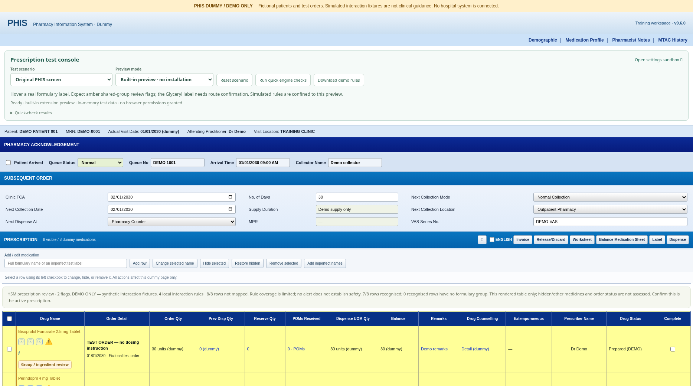

# PHIS dummy demo · v0.6.0

This local training page approximates the PHIS screenshot: blue section bars, collection fields, medication icons, and a yellow prescription grid. Patient, prescriber, and order details are fictional. No hospital connection is needed.

## Open the demo

1. Download the [repository ZIP](https://github.com/vasfplhsm/PHIS-HSM-Formulary-Integration/archive/refs/heads/main.zip) and extract **all** files.
2. Open **OPEN-DEMO.html** in Edge or Chrome. It contains the scripts, styles, and formulary data needed for the built-in prescription preview.
3. Wait for **Ready · built-in extension preview**. Leave **Preview mode** on **Built-in preview · no installation**.
4. Choose **Major interaction 1 · DEMO ONLY** under **Test scenario**. DEMO Alpha and DEMO Beta should turn red. Click **Interaction alert** to read the simulated explanation.
5. Hover other recognised medicines for their reference. Move the pointer into the popup to scroll it; the medication name remains at the top. Escape or **Close** dismisses it.

The linked settings sandbox needs the other extracted folders alongside the HTML. Its settings exist only in that page's memory and reset on reload. It does not update the prescription preview or the installed extension.

### If your browser blocks local HTML

Opening `file://` pages could not be verified in the cloud browser because its managed policy blocks them. The self-contained HTML and the multi-file preview were tested through a local HTTP server.

If Python is already installed and local servers are allowed on your computer, open a terminal in the extracted **repository root** (the folder containing OPEN-DEMO.html and extension), then run:

```sh
python -m http.server 8080 --bind 127.0.0.1
```

On Windows, `py -m http.server 8080 --bind 127.0.0.1` may be the available command. Open `http://127.0.0.1:8080/OPEN-DEMO.html` in Edge. The alternative entry point is `http://127.0.0.1:8080/demo/index.html`. Both use the same demo and extension sources. Stop the server with Ctrl+C when finished. Follow your organisation's browser and software policies.

## Scenario checklist

All red interaction examples are fictional UI fixtures. They do not describe real drug interactions or clinical management.

| Preset | What to check |
| --- | --- |
| Original PHIS screen | Eight screenshot/reference labels; hover indications and dosage from HSM CSV. Glyceryl needs product/route confirmation. |
| Major interaction 1 | DEMO Alpha + DEMO Beta: two red names and simulated major explanation. |
| Major interaction 2 | DEMO Gamma + DEMO Delta: second independent major pair. |
| Contraindicated pair | DEMO Alpha + DEMO Delta: two red names and simulated contraindicated explanation. |
| Multiple severities | Four fictional medicines; two major pairs, one contraindicated pair, and one moderate pair. Contraindicated explanations come first. |
| Moderate interaction | DEMO Beta + DEMO Gamma: amber review badges. |
| Shared formulary group | Bisoprolol and Perindopril: amber shared CSV-group flags, with no claim of a confirmed interaction. |
| Imperfect names / missing details | Possible matches require **View reference** before indication/dosage appears. These uncertain labels are excluded from interaction screening. |
| Brand names / ambiguous strength | Dexilant offers two strength choices; Jardiance resolves to its single formulary record. |
| Unrecognised medicines | No invented reference; coverage shows unrecognised rows. |
| No interaction rules loaded | No red pair flags; explicit message that drug interactions are not checked. |
| Separate prescriptions / no cross-check | One fictional partner in each table; no cross-table pair alert. |

For a dynamic test, select DEMO Beta using its left checkbox in **Major interaction 1**, then choose **Hide selected**. Both red alerts should clear. **Restore hidden** restores the pair; **Remove selected** clears it again. Use **Reset scenario** to start over. You can also change a selected label or add a medicine using the input above the grid.

**Run quick engine checks** runs eight small checks against the actual matching and rule logic. It supplements the automated browser suites. Invoice, release, label, and dispense buttons only display a dummy status message; they send no transaction.



## Demo rules and clinical import

The four synthetic rules are in `demo/scenarios.js`. They use fictional DEMO products and `purpose: synthetic-demo`, with `review.status: demo`. Their source explicitly says there is no clinical evidence. Fictional products never enter the bundled clinical formulary.

**Download demo rules** exports these fixtures for inspection. Import that download in the **settings sandbox** to check that it is rejected as clinical rules. Changing the review status alone still cannot make a demo fixture pass validation. The normal clinical importer has no demo override.

The built-in preview enables fixtures only on local-file or loopback pages marked as the demo. Normal extension configuration does not enable demo rules. The clinical extension still requires reviewed mappings and source-cited rules from your clinical team; see [rules format](rules-format.md).

## Test the installed extension separately

Use the HTTP server entry point above. Select **Installed extension · real permissions**; this reloads the page without the built-in popup or simulated APIs. Enable the exact local HTTP address in the installed extension and refresh the page. Registering localhost does not grant hospital access. Use this mode when the installed extension is active on the demo address, to avoid running two popup implementations together.

This mode uses the installed extension's own CSV, permissions, and reviewed rules. Synthetic DEMO pair alerts are intentionally unavailable; use the original-screen, imperfect-name, or shared-group presets to check its behaviour. The preview settings sandbox cannot configure the installed extension; use its toolbar popup.

## Validation and limits

Version 0.6.0 has 32 passing unit tests and four passing browser suites. Tests cover the shipped self-contained HTML, all 12 presets, sticky scrolling, matching and candidate selection, red/amber severity display, row edits/hiding/removal, separate tables, missing rules, source labels, CSV import/restore, demo-rule rejection, and origin isolation. No external runtime requests are needed for the demo.

Browser APIs and permission results are simulated in the automated suites. Cloud browser policy prevents checking direct-file navigation and unpacked-extension installation. Live PHIS selectors, frames, and behaviour remain unverified until sanitised HTML is available. This demo tests interface behaviour and rule plumbing; it does not validate clinical completeness or treatment recommendations.

Developers: run `node scripts/build-demo.cjs` after editing sources, then run the test commands in the [README](../README.md#demo-and-checks).
